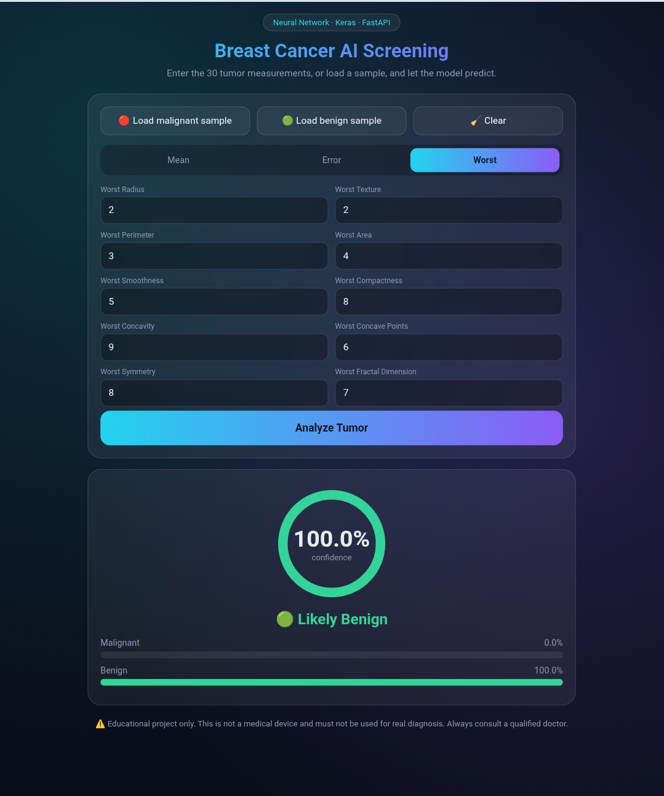

# Breast Cancer Predictor

A neural network (Keras) that predicts whether a tumor is malignant or benign
from 30 measurements, served with FastAPI and a dark glass-style web UI.



## Model
- Dataset: Breast Cancer Wisconsin (scikit-learn)
- Architecture: 30 -> Dense(32) -> Dropout(0.3) -> Dense(16) -> Dense(1, sigmoid)
- Test accuracy: about 96-97%, malignant recall: 0.98
- Features are scaled with StandardScaler, fitted on training data only

## Run locally
```
pip install -r requirements.txt
python app.py
```
Then open http://localhost:8000

## API
- GET /features: list of the 30 feature names
- GET /sample?kind=malignant|benign: random sample row
- POST /predict: send {"features": [30 numbers]}, get label and probabilities
- GET /docs: interactive Swagger page

## Disclaimer
Educational project only. Not a medical device. Do not use for real diagnosis.
